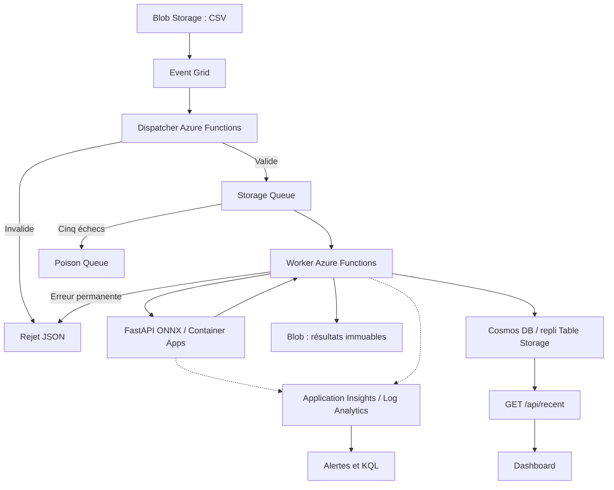

# DSCC — Apprentissage automatique événementiel sur Azure
## Prédiction de l'attrition des clients télécoms

**ECE Paris — MSc 2 Intelligence artificielle — Distributed Systems and Cloud Computing in AI**
**Équipe :** Gémima ONDELE POUROU, Yaye Aminata DIAGNE, Elias CREMNITER, Omar KRARTI.
**Soutenance :** 2 décembre 2026. **État :** brouillon consolidé du 28 novembre, à intégrer au Word collaboratif OneDrive. Ni PDF final ni recette cloud validée.

## 1. Résumé et objectifs
Nous concevons une chaîne de traitement de fichiers CSV permettant de prédire le risque de départ des clients télécoms. L'architecture découple ingestion, orchestration, inférence, persistance, visualisation et supervision. Elle vise la reproductibilité, les reprises bornées, l'idempotence des résultats, la maîtrise des coûts et la traçabilité. Les tests hors cloud démontrent la faisabilité technique ; la recette sur Azure reste à réaliser.

## 2. Architecture et contrat

Le contrat #14, fusionné, définit 19 variables prédictives, customerID comme identifiant et Churn comme cible exclue de l'inférence. Les événements peuvent être livrés plusieurs fois. L'ETag évite de traiter une nouvelle version au titre d'un événement ancien. Une sortie immuable par nom de blob et ETag et la récupération des métadonnées garantissent l'idempotence des résultats persistés, mais n'excluent pas des appels d'inférence concurrents. Le partitionnement Cosmos par /fileName et le repli Table Storage restent à éprouver dans le cloud.

## 3. Données et modèle
Régression logistique, split stratifié 80/20, graine 42, imputation médiane, mise à l'échelle et encodage one-hot. ONNX 1.1.0 : 4 variables numériques et 15 catégorielles. Les deux compteurs de tickets sont exclus car leur disponibilité avant le churn n'est pas établie ; l'ablation ne prouve pas une fuite.

| Indicateur rapporté | 1.1.0 (19 variables) | 1.0.0 historique (21) | Baseline majoritaire |
|---|---:|---:|---:|
| AUC | 0,8413 | 0,9273 | 0,5000 |
| F1 | 0,6136 | 0,7328 | 0 |
| Exactitude | 0,7381 | 0,8318 | 0,7346 |

Matrice de confusion rapportée sur 1 409 lignes : [[747, 288], [81, 293]]. Écart maximal de probabilité ONNX/scikit-learn rapporté : 1,495e-7. Ces chiffres proviennent de #18 et ne constituent pas une nouvelle reproduction indépendante. Les quatre contrôles CI hors dataset sont réussis ; quatre tests dépendant du dataset sont désélectionnés. Omar rapporte huit tests locaux. La permission d'utiliser le classeur PwC/Forage exact et celle de publier l'artefact dérivé restent à établir ; le retrait des fichiers du tree courant ne règle pas l'historique. Garder DATASET_USE_APPROVED et MODEL_ARTIFACT_PUBLISH_APPROVED désactivés. Ne pas fusionner #18 tant que ce blocage n'est pas levé.

## 4. API et pipeline
API : GET /health, GET /version, POST /predict, POST /predict/batch, GET /metrics. Validation stricte des entrées, rejet HTTP 422 permanent ; réseau, 429 et 5xx transitoires. Le dispatcher contrôle format, taille, colonnes et version ; le worker appelle l'API avec timeouts de 2 s (connexion) et 10 s (lecture). Le host configure maxDequeueCount=5. Les rejets n'exposent pas de valeurs brutes. Le pipeline stocke prédictions et agrégats, puis expose les résultats récents. #27 plafonne RECENT_LIMIT et la réponse /api/recent à 20 pour les configurations positives ; les limites inférieures sont conservées. Le correctif est testé séparément et non encore fusionné.

## 5. Infrastructure, collaboration et CI/CD
Abonnement Azure for Students retenu : celui de la coordinatrice ; groupe rg-projet-g2cc en France Central. Préparation historique : budget 4 EUR/mois, alertes 20/50/80 %, identité managée fédérée, rôle Contributor limité au groupe pour le déploiement. L'OIDC en lecture seule a réussi (run 45966902708, tentative 2) ; #26 a corrigé le sujet de fédération. Aucun déploiement applicatif n'est attesté.

Cible : Storage LRS, Cosmos Free Tier si éligible (sinon repli explicite), Container Apps Consumption 0,25 vCPU/0,5 Gio, 0–2 réplicas ; Functions Flex Python 3.12 (512 Mio sous réserve de quota), Event Grid, Application Insights et Log Analytics (plafond 0,2 Go/jour). Refaire les vérifications régionales, quotas, Free Tier et what-if avant création. Les accès humains sont à configurer séparément via Entra et RBAC sur le seul groupe ; aucun partage de session. Voir docs/azure-access-guide.md.

GitHub Actions : tests et construction Docker, publication GHCR et déploiement sous autorisation explicite. La publication historique 1.0.0 (run 45880950088) n'est pas une release intégrée ni une preuve de déploiement. Les protections de main et de l'environnement production sont distinctes. Ne pas activer les commutateurs de publication/déploiement sans autorisation.

## 6. Dashboard et observabilité
Le dashboard Chart.js consomme /api/recent toutes les 30 s, valide le schéma et conserve les données précédentes en cas d'erreur. Le mode simulé est identifié et activé par défaut si apiBaseUrl est vide. Affichage : fichiers, clients, risque, probabilité pondérée, durée et versions. Les métriques OpenTelemetry, scripts KQL et alertes de #20 sont fusionnés ; les gardes de commandes ont été testées avec des doubles, pas avec Azure. Aucune donnée individuelle dans les captures ou labels.

## 7. Résultats et preuves
| Périmètre | Résultat et lien |
|---|---|
| API #17 | 16 tests, Ruff, Docker et taille <500 Mo : [45961769605](https://github.com/GemimaOndele/DSCC-Azure-Event-Driven-ML/actions/runs/45961769605) |
| ML #18 | 4 contrôles hors dataset, 4 désélectionnés : [45961524670](https://github.com/GemimaOndele/DSCC-Azure-Event-Driven-ML/actions/runs/45961524670) |
| Pipeline #21 | 72 tests, Ruff : [45962557654](https://github.com/GemimaOndele/DSCC-Azure-Event-Driven-ML/actions/runs/45962557654) |
| Aperçu intégré #22 | 107 tests (16 API, 72 pipeline, 2 ONNX, 17 Node), gardes simulées : [46140778592](https://github.com/GemimaOndele/DSCC-Azure-Event-Driven-ML/actions/runs/46140778592) |
| Répétition des fusions #22 | 55/55 paires propres : [46140778562](https://github.com/GemimaOndele/DSCC-Azure-Event-Driven-ML/actions/runs/46140778562) |
| ONNX/Azurite #22 | 2 + 3 tests : [46140778585](https://github.com/GemimaOndele/DSCC-Azure-Event-Driven-ML/actions/runs/46140778585) |
| Correctif #27 | 76 tests pipeline dont 4 nouveaux, Ruff : [46141028861](https://github.com/GemimaOndele/DSCC-Azure-Event-Driven-ML/actions/runs/46141028861) |
| CI #27 | Succès sur branche, étapes conditionnelles potentiellement ignorées : [46141028906](https://github.com/GemimaOndele/DSCC-Azure-Event-Driven-ML/actions/runs/46141028906) |
| CI historique de main fce70111 | Échec des gates fichiers training/dashboard/E2E : [45990705903](https://github.com/GemimaOndele/DSCC-Azure-Event-Driven-ML/actions/runs/45990705903). Actualiser après les fusions ; aucun run plus récent sur main vérifié. |

Les 76 tests ne s'ajoutent pas aux 107 : #27 n'est pas dans cet aperçu. Les tests Azurite concernent Blob/Queue/Table, non Cosmos, Event Grid ou le host Functions réel. Restent à prouver : E01–E11, CSV valide sous 60 s, rejet, cinq reprises et poison, idempotence, dashboard réel, KQL/alerte/e-mail, digest/version déployée, scale-to-zero, coûts et nettoyage.

## 8. Coûts
Estimation historique France Central pour sept jours : 2,4169 USD, dont 1 USD de réserve ; scénario plafond logs 5,7289 USD. Ces chiffres ne sont pas un relevé de consommation. Le budget 4 EUR/mois est une alerte, pas un plafond bloquant ; cible interne <5 USD et plafond projet 25 USD. Free Tier Cosmos conditionnel ; confirmer les frais avant provisionnement. Voir infra/cost-readiness-2026-11-27.md. Joindre Cost Analysis daté, devise, écart réel/prévu et preuve de nettoyage après soutenance.

## 9. Organisation et risques
R1 Elias : modèle/API ; R2 Gémima/Aminata : pipeline ; R3 Aminata/Gémima : Azure et CI/CD ; R4 Omar : dashboard, supervision et coûts. Gémima coordonne la livraison. Au checkpoint du 28 novembre, main fce70111 contient #14, #15, #17, #20, #21, #23, #24, #25 et #26 fusionnées. PR techniques ouvertes : #18 e7d8272, #19 ccb406c, #22 13f1b75, #27 7c669a7 ; #28 documentaire ouverte. Les revues du 28 novembre par Elias sont COMMENTED, pas APPROVED. Omar a notamment approuvé #18 au SHA e7d8272 ; cette approbation technique ne lève ni les droits non établis ni la demande de modifications antérieure. Chaque approbation est liée à un SHA. Les droits, les quotas, les revues humaines et la recette Azure constituent les risques principaux.

## 10. Conclusion provisoire et pièces à compléter
La faisabilité hors cloud est étayée. Le rapport final doit séparer résultats observés, hypothèses et éléments non réalisés. Insérer les captures Azure redigées (abonnement/région/quotas, IAM, déploiement, CSV, rejet/poison, dashboard, KQL/alerte, scale-to-zero, coûts), journal des heures réelles de chacun et preuves de nettoyage. Ne pas inventer d'heures ni de résultats. Le Word OneDrive partagé est le rapport de référence ; ce Markdown sert de source de contenu et de traçabilité. Répétition : 10 min + 5 min de questions.

Historique détaillé des preuves : [registre au 27 novembre](https://github.com/GemimaOndele/DSCC-Azure-Event-Driven-ML/blob/fce70111aef1bc62a024c7a20d9913891f5727ef/docs/evidence-register.md). [Registre actualisé](evidence-register.md).

## Point de contrôle du 28 novembre — accès et intégration

La coordinatrice a exécuté dans Azure Cloud Shell les opérations suivantes : abonnement Azure for Students actif, groupe rg-projet-g2cc en francecentral, identification des trois comptes Entra, absence d'attribution individuelle retournée avant modification, création puis relecture de quatre attributions au périmètre du groupe : Aminata Contributor ; Elias Reader ; Omar Reader et Monitoring Contributor. Lien direct du groupe généré pour diffusion interne uniquement. Les captures 03–07 sont conservées pour le Word collaboratif ; aucune adresse électronique, identifiant d'abonnement ou lien contenant cet identifiant ne doit être publié. L'accès effectif de chacun reste à confirmer ; aucun provisionnement applicatif ni coût mesuré n'est attesté par cette opération. Voir [Issue #3, preuve RBAC](https://github.com/GemimaOndele/DSCC-Azure-Event-Driven-ML/issues/3#issuecomment-7240106239).

Le nouvel aperçu intégré #22 au SHA 5687bf4 inclut #18 fd1e6fe et #27 7c669a7 : **111 tests** (16 API, 76 pipeline, 2 ONNX, 17 Node), Ruff et gardes simulées réussis, [run 46147650653](https://github.com/GemimaOndele/DSCC-Azure-Event-Driven-ML/actions/runs/46147650653). [66/66 paires sans conflit](https://github.com/GemimaOndele/DSCC-Azure-Event-Driven-ML/actions/runs/46147650574) et [2 ONNX + 3 Azurite](https://github.com/GemimaOndele/DSCC-Azure-Event-Driven-ML/actions/runs/46147650662). Cette preuve remplace le précédent aperçu 107 tests pour le périmètre combiné, mais ne couvre pas la PR documentaire #28 ni les tests cloud. Elias a approuvé #19 ccb406c et #27 7c669a7 ; #19 demeure bloquée par une revue antérieure. #18 conserve le blocage de droits, malgré le nouveau brouillon d'autorisation. Publication et déploiement restent désactivés.
