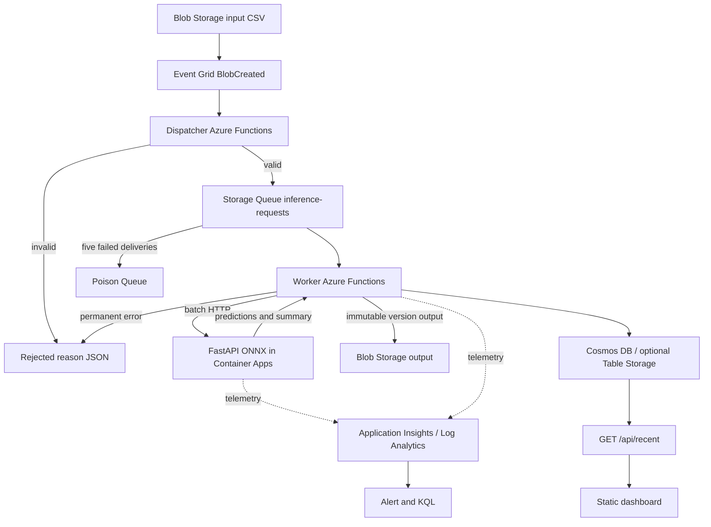

# DSCC — Event-driven machine learning on Azure
## Telecom customer attrition prediction
**MSc 2 Artificial Intelligence | Distributed Systems and Cloud Computing in AI | ECE Paris**

**Team:** Gémima ONDELE POUROU, Yaye Aminata DIAGNE, Elias CREMNITER, Omar KRARTI  
**Defense:** 2 December 2026  
**Document status:** working report, 26 November 2026. Evidence still being collected. Not the final PDF.

## 1. Executive summary

We designed a serverless, event-driven machine learning system to score telecom
customer attrition risk from uploaded CSV batches. The architecture separates data
ingestion, orchestration, model inference, persistent results, dashboard and
observability. Our objectives are reproducibility, bounded retries, safe
handling of duplicated events, controlled infrastructure costs and traceable delivery.

The reference implementation includes an ONNX classification model served by FastAPI,
a Python Azure Functions dispatcher and worker, a recent-results endpoint, and an
observability/dashboard layer. As of this draft, development is conducted on separate
reviewed branches. Cloud deployment and final acceptance remain to be demonstrated.

## 2. Scope and requirements

- Accept valid CSV batches, reject malformed input without unnecessary retries.
- Validate one shared model contract and produce one prediction per customer.
- Persist results with an idempotency key derived from blob name and ETag.
- Limit transient queue processing to five deliveries, then poison queue.
- Expose the 20 most recent successful results to an automatically refreshing dashboard.
- Build and test using GitHub Actions; publish versioned container artifact to GHCR
  only after dataset rights and package publication are approved.
- Deploy to an authorized student Azure subscription using managed identity and
  federated OIDC; budget target at most USD 25, no VM/GPU/Kubernetes.
- Demonstrate monitoring queries, an alert, actual costs and resource cleanup.

## 3. Architecture

Storage events are delivered at least once. The dispatcher checks the declared input
and conditionally downloads the event version. The worker validates the CSV, invokes
the batch API with explicit timeouts, validates the response, and writes the canonical
result. A versioned, create-only result blob allows retry recovery and avoids
overwriting the output of another ETag. Concurrent duplicate deliveries can still
call inference more than once; only durable output and metadata are idempotent.
Cosmos point reads use /fileName as partition key. A fallback Table Storage path
requires explicit deployment and performance validation.

Contract pending team approval: versioned output naming, superseded-event handling,
final feature count, data provenance and publication rights. The planned integration
uses shared schema rather than independent inconsistent copies.

## 4. Data and model

The current model is logistic regression trained with stratified 80/20 split,
random seed 42, median imputation, scaling and one-hot encoding, exported to ONNX.
The current schema has 21 predictive variables including two ticket counters.
customerID identifies an input row; Churn is the target and is excluded from inference.

Reported metrics from PR #18, not independently reproduced for this report:

| Metric | Current 21-feature model | Majority baseline |
|---|---:|---:|
| AUC | 0.9273 | 0.5000 |
| F1 | 0.7328 | 0.0000 |
| Accuracy | 0.8318 | 0.7346 |

The availability of ticket counts before the prediction date is not demonstrated.
An ablation reported by Omar gives AUC 0.8413 and F1 0.6136 for 19 features.
This is a leakage risk, not proof of leakage. The team must choose the final
feature set and document the limitation. Third-party dataset use, automated
download, derivative artifact publication and redistribution permissions are not
yet positively confirmed. Educational purpose alone does not establish a license.
Do not present the metrics as production generalization or publish the artifact
until the authorization issue is resolved.

## 5. ML API

Canonical routes: GET /health, GET /version, POST /predict,
POST /predict/batch, GET /metrics. The batch API consumes {"rows":[...]} and returns
predictions, summary, model_version and latency_ms. Strict validation rejects invalid
features and non-finite numeric values. HTTP 422 is a permanent input error;
transient network/429/5xx failures are retried by the worker.
Evidence: #17, current head 5886584, run 45883545674: 15 API tests, Ruff, Docker build and the <500 MB image gate. The GHCR workflow on #17 is now manual and opt-in, and publishes only `preview-<commit-sha>`; no new publication followed that change. The historical branch publication run 45880950088 (SHA 6fb916d, tags 1.0.0 and sha-6fb916d19230cdd29fccffccdf3722704f1f8b25, digest sha256:7932660bde49aeeaffad67fd58f5609a80ab123b11b632d663a0f88adab3b3f8) remains branch proof only. It establishes neither final integrated release, artifact rights, package visibility nor Azure deployment.

## 6. Pipeline and distributed systems

The Python Functions v2 app contains dispatcher, worker and recent. The message has
blobName, etag, size and enqueuedAt. The host sets maxDequeueCount=5. The worker
uses 2 s connect and 10 s read timeouts and checks response consistency before
persistence. The output key is scoped to the blob version. Failed CSV values are
not echoed in rejection messages. Malformed queue envelopes are rejected.
Retry/poison behavior must be shown on an actual Azure Functions host.

Verified evidence: PR #21 commit 192e4c04c11da9299d0f14f0ff894e7265ad5265,
GitHub Actions run 45878414101, job 140111279553, 61 offline tests passed; after Elias's review, #21 at 503280a passed 70 tests and Ruff in run 45882123936, with the CSV customerID pattern aligned to the API.
These tests use in-memory adapters and HTTP mocks; they do not prove real Azure
SDK behavior or end-to-end cloud operation. Independent integration preview #22,
run 45878841099, verified 2 tests passed with the real ONNX API and synthetic inputs,
using pinned API 5388f1c and pipeline 192e4c0 without merging main. The refreshed preview at #22 886ee85 against API 69cf39c and pipeline 503280a again passed both tests (run 45882194925). The latest approved QA preview at #22 65c11e9 pinned API 5886584 and pipeline 503280a and passed 2 real ONNX plus 3 isolated Azurite SDK tests (run 45884397529), still without merging branches or touching Azure.

## 7. Infrastructure, security and CI/CD

Target: one resource group, one storage account, Cosmos Free Tier if available,
Container Apps consumption (0.25 vCPU, 0.5 GiB, 0–2 replicas), Functions Flex
Consumption Python 3.12 (512 MiB subject to validation), Event Grid, Application
Insights and Log Analytics cap 0.2 GB/day. Use managed identity for Azure resource
access; GitHub Actions uses UAMI federation with restricted RG scope and OIDC.
No hard-coded secrets. GHCR authentication is separate from ARM OIDC; private
registry pull permissions must be approved and configured.

The Azure sharing guide #15 is merged. The coordinator confirms that both Gémima and Aminata have sufficient student credits, based on previously shared evidence; no new balance is asserted. The single selected subscription, region, quotas and actual RBAC remain pending. PR #24 now contains base.bicep, apps.bicep and a guarded bootstrap, validated by GitHub Actions run 45880668170 (both templates compiled, shell syntax and refusal without approval tested). No Azure resources were deployed. The proposed CI/CD checks the API,
pipeline and authorized training; GHCR and Azure deployment are explicitly gated.
Deployment must be manually approved, pin the commit image digest, validate
GET /version, then deploy the existing Flex Functions package. No resources are
provisioned automatically by this draft.

## 8. Dashboard and observability

The static dashboard targets GET /api/recent, refreshes every 30 seconds, and
shows file/customer counts, risk, mean probability, latency and model version.
PR #19 now includes strict payload validation and 16 passing Node tests. PR #20 adds OpenTelemetry metrics:
inferred_rows, inference_latency_ms, inference_requests and inference_errors,
plus KQL and email alert logic. Dedicated R4 CI now passes 15 API tests, Ruff, Docker and offline command guards (45884243968); these overlap the R1 tests and are not extra unique tests. Cloud telemetry evidence remains pending. The R4 alert script reuses existing R3 resources and requires explicit owner consent.
No customer values should be written to metrics labels or screenshots.

## 9. Testing and evidence

| Evidence | Status at draft |
|---|---|
| API PR #17 CI | Verified 15 tests, Ruff and Docker build |
| Training PR #18 CI | Verified 8 tests and Ruff; dataset rights/feature decision outstanding |
| Pipeline PR #21 CI | Verified 70 offline tests and Ruff passed |
| Integrated real-ONNX pipeline | Latest approved preview: 2 ONNX + 3 Azurite tests, run 45884397529; pinned API 5886584 and pipeline 503280a; earlier ONNX-only refresh in run 45882194925; no Azure |
| Local Azure SDK integration (Azurite) | Verified 3 tests, run 45883033290; Blob/Queue/Table, not Cosmos or Functions host |
| Git pairwise integration rehearsal | Refreshed 12 pairs: 3 conflicts, 9 clean (45884397543), down from 5 conflicts |
| Sequential integrated preview | 10 pinned PRs, 103 tests (15 API + 70 pipeline + 2 ONNX + 16 dashboard), Ruff and mocked R4 guards passed (45884397493) |
| Azure E2E under 60 s | Not performed |
| Rejection and poison queue in Azure | Not performed |
| Dashboard, KQL, fired alert and email | Not performed |
| GHCR image digest and manual deployment/version | Branch image publication verified; final release and Azure deployment not performed |
| Scale-to-zero | Not performed |
| Cost Analysis and cleanup | Not performed |

Evidence files should include UTC date, exact commit, environment, test ID,
expected/observed result and owner, with secrets/personal data redacted.

The QA branch also verifies the real Azure Storage SDK against isolated Azurite (Blob, Queue and Table): ETag conditional reads, Base64 queue payload, immutable concurrent writes, metadata recovery and sanitized rejection. Three tests passed in run 45883033290 after correcting the test fixture credential type. No actual Azure authentication, Cosmos DB, Event Grid or Functions host was exercised. The emulator uses a pinned image and a deliberately synthetic local key. A pairwise Git merge-tree rehearsal confirmed five conflicting pairs and seven clean pairs; see docs/integration-plan.md. No remote merge was performed.

## 10. Cost model and actual costs

Budget ceiling proposed: USD 25; alerts at 20%, 50%, 80%. Budgets are alerts, not
hard spending caps. Estimate after selecting region, expected number of uploads,
invocations and log ingestion. Do not invent prices or actual consumption.

| Item | Planned configuration | Estimated cost | Actual cost |
|---|---|---|---|
| Storage / transactions | LRS, small CSV and results | Pending | Pending |
| Cosmos or Table | Free Tier if eligible / explicit fallback | Pending | Pending |
| Functions | Flex, low demo volume | Pending | Pending |
| Container Apps | Consumption, min 0 max 2 | Pending | Pending |
| Event Grid | Low event volume | Pending | Pending |
| Log Analytics / alerts | 0.2 GB/day cap | Pending | Pending |
| Total | Target ≤ USD 25 | Pending | Pending |

Record Cost Analysis timestamp and currency, estimate vs actual, then explain
variance. No claim of zero spend without subscription evidence.

## 11. Project organization and risks

R1 Elias: ML/model API; R2 Aminata and Gémima: event pipeline; R3 Aminata and
Gémima: Azure/CI-CD; R4 Omar: dashboard, observability and costs. Gémima coordinates
integration and delivery. GitHub protected main, independent PR review, evidence-based
issue closure. Do not approve own PR. All team members should understand a second
domain for Q&A. Main currently contains #15; other technical components remain PRs. #21 and #22 are ready for independent review, with CI evidence; #23 CI/CD and #24 compiled infrastructure templates are prepared for review. #25 is this working report.

Priority risk register:
- dataset rights and temporal feature validity — Elias + team;
- contract consistency and versioned outputs — Aminata/Elias/Gémima;
- selected subscription, regional restrictions and quota — Aminata/Gémima (credit sufficiency confirmed by coordinator);
- cross-branch conflicts and missing integrated CI — Gémima;
- dashboard validation, monitoring and alert evidence — Omar;
- limited schedule — all members; avoid deferring integration to defense eve.

## 12. Conclusion and future work

The architecture and offline tests support the feasibility of an event-driven
ML pipeline. The final conclusion must distinguish observed implementation and
cloud acceptance. Future improvements include stricter distributed execution
deduplication, scalable fallback queries, stronger input schema management and
time-aware model validation. Complete this report only after verified deployment,
acceptance, costs and final human approval.

## Appendix — evidence links
- Contract #14: https://github.com/GemimaOndele/DSCC-Azure-Event-Driven-ML/pull/14
- Azure guide #15: https://github.com/GemimaOndele/DSCC-Azure-Event-Driven-ML/pull/15
- API #17: https://github.com/GemimaOndele/DSCC-Azure-Event-Driven-ML/pull/17
- Training #18: https://github.com/GemimaOndele/DSCC-Azure-Event-Driven-ML/pull/18
- Dashboard #19: https://github.com/GemimaOndele/DSCC-Azure-Event-Driven-ML/pull/19
- Observability #20: https://github.com/GemimaOndele/DSCC-Azure-Event-Driven-ML/pull/20
- Pipeline #21: https://github.com/GemimaOndele/DSCC-Azure-Event-Driven-ML/pull/21
- Pipeline CI: https://github.com/GemimaOndele/DSCC-Azure-Event-Driven-ML/actions/runs/45878414101
- E2E preview #22: https://github.com/GemimaOndele/DSCC-Azure-Event-Driven-ML/pull/22
- E2E CI: https://github.com/GemimaOndele/DSCC-Azure-Event-Driven-ML/actions/runs/45878841099
- CI/CD #23: https://github.com/GemimaOndele/DSCC-Azure-Event-Driven-ML/pull/23
- Azure preflight #24: https://github.com/GemimaOndele/DSCC-Azure-Event-Driven-ML/pull/24
- Team board: https://github.com/users/GemimaOndele/projects/5
