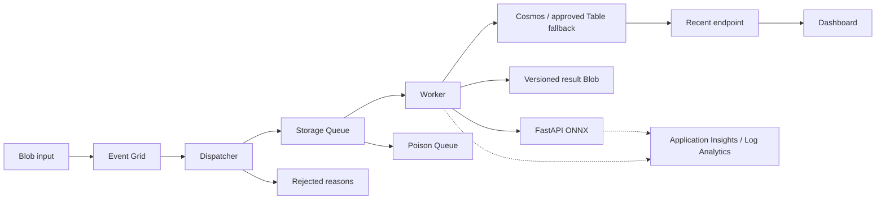

# DSCC — Azure Event-Driven Machine Learning

ECE Paris · MSc 2 Artificial Intelligence · Distributed Systems and Cloud Computing in AI  
Team: Gémima ONDELE POUROU, Yaye Aminata DIAGNE, Elias CREMNITER, Omar KRARTI  
Defense: 2 December 2026.

> Release README proposal. Replace the root README with this content only after
> independent review, final schema/data-rights decision and verified integration.
> Current preview is not an Azure deployment or an approved release.

## Purpose

Score telecom attrition risk from small CSV batches using a serverless,
queue-decoupled machine learning pipeline with reliable persistence, observability,
CI/CD and controlled costs.



## Component and evidence map

| Domain | Source | Current review |
|---|---|---|
| Project organization | docs/project-overview.md; docs/technical-contract.md | #14 merged (3e298c1) |
| Azure access | docs/azure-access-guide.md | #15 merged |
| ML API | api/; model/features.json | #17 merged (1357387) |
| Training and provenance | model/DATASET.md; model/FEATURE_RISK_ANALYSIS.md; model/TRAINING_EVIDENCE.md | #18 review renewed with Gémima |
| Event pipeline | functions/README.md; functions/src/ | #21 merged (0f2d4f2) |
| Dashboard | web/README.md | #19 re-review requested |
| Monitoring | docs/observability/README.md | #20 R4-only delta 900c728 |
| QA | tests/e2e/README.md | #22 re-review requested |
| CI/CD | .github/workflows/ci.yml; deploy.yml | #23 merged (b519575) |
| Azure IaC | infra/DEPLOYMENT.md | #24 merged (e56f77c), #26 merged (c67bafc) |
| Report and release evidence | docs/final-report-draft.md; docs/integration-plan.md; docs/evidence-register.md | #25 finalisation in progress |

## Model and API

The existing model is logistic regression exported to ONNX (1.1.0), stratified
80/20 split with seed 42, median imputation, scaling and one-hot encoding.
The current integration target uses 19 predictive inputs (15 categorical, 4 numeric), excluding customerID and Churn. The two ticket counts are rejected as extra inputs.
The two ticket counters have no demonstrated pre-churn availability. Reported
ablation: 21 features AUC 0.9273/F1 0.7328; 19 features AUC 0.8413/F1 0.6136.
R1/R4 selected 19 variables on 27 November; core integration on main is complete, while case-workbook authorization and derivative publication rights remain pending. Do not fetch the workbook or publish an
artifact without appropriate permission. The case workbook is not the raw IBM
dataset. See model/DATASET.md and model/FEATURE_RISK_ANALYSIS.md.

Run the existing model offline with synthetic inputs only:
```bash
python -m pip install -r api/requirements-dev.txt
python -m uvicorn api.main:app --host 127.0.0.1 --port 8000
```

Routes: GET /health, GET /version, GET /metrics, POST /predict (single),
POST /predict/batch ({"rows":[...]}). Construct the exact feature set from
model/features.json. See tests/e2e/test_pipeline.py for synthetic examples.
Do not pass customerID as a feature or Churn in the inference request.

## Reliability and security

Conditional ETag reads, validated CSV, one immutable output per blobName+ETag,
metadata recovery, bounded five queue deliveries and poison queue.
Concurrent duplicate delivery may trigger more than one inference call;
persisted results are idempotent, not exactly-once execution. No raw customer
values in rejection reasons. Managed identity and scoped RBAC; no shared
passwords or keys. Public endpoints require explicit temporary synthetic-demo
approval; CORS is not authentication.

## Verification

Run the following separately in Python 3.12 from the repository root after
approved integration:
```bash
python -m pip install -r api/requirements-dev.txt -r functions/requirements.txt ruff==0.9.10
python -m ruff check api functions
python -m pytest api/tests -q
python -m pytest functions/tests -q
python -m pytest tests/e2e/test_pipeline.py -q
node --test tests/dashboard/test_data.cjs
bash tests/observability/test_guards.sh
```
The last script uses mock commands only; no alert or Azure resources created.
See QA workflow for isolated Azurite SDK tests and conflict rehearsal. Training
tests may fetch the case data; do not run them without authorization.

## Deployment and cost

One selected Azure for Students subscription, maximum budget USD 25 (internal
target under USD 5), approved region/quotas, one project RG, budget alerts at
20/50/80%. Credits are sufficient on both student subscriptions per coordinator;
the coordinator's subscription and France Central are recorded as selected; actual deployment still requires owner validation. See the merged #24 setup evidence and cost-readiness note. Read-only OIDC succeeded on main (45966902708 attempt 2); the matching IaC fix #26 was merged at c67bafc. Application infrastructure, actual quota and effective Free Tier remain pending.
Use infra/DEPLOYMENT.md, Bicep what-if then explicitly approved provisioning.
GHCR branch publication is not a final release. Main publication and Azure
deployment require artifact approval and explicit gates. Record real deployment,
E2E, alerts, actual costs and eventual authorized cleanup before closing tickets.

Current evidence: see docs/evidence-register.md and the PR CI logs; no unverified
cloud claim. Team board: https://github.com/users/GemimaOndele/projects/5.
